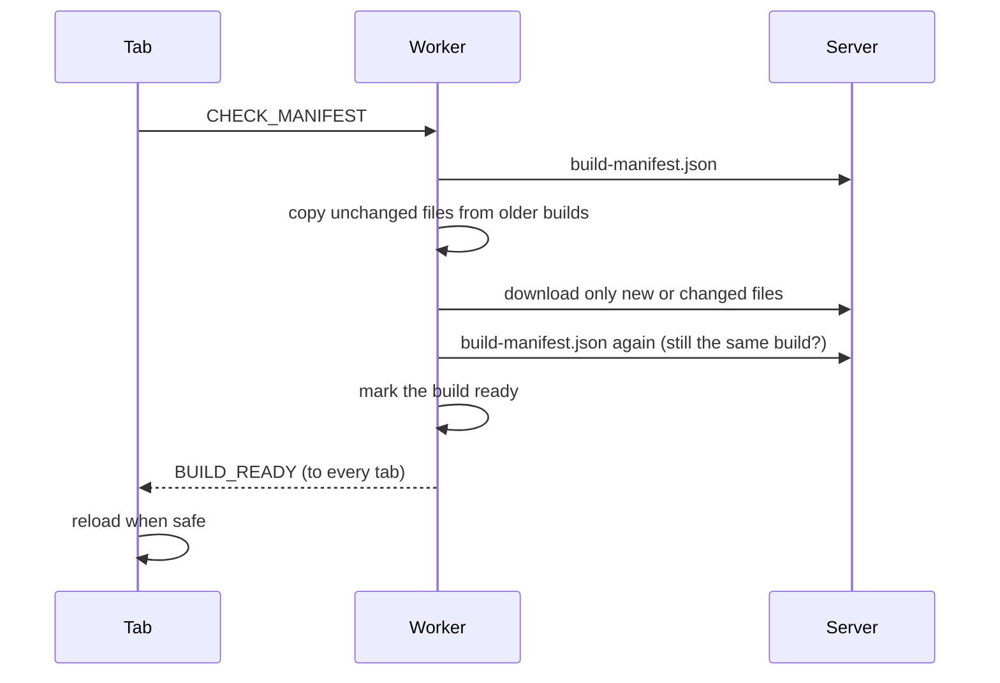

# Service worker

The service worker gives the website three things:

- **Offline mode.** The last complete version of the site opens without a network.
- **Updates without stale tabs.** A new tab gets the newest version right away, and open tabs reload by themselves once a new version is fully downloaded.
- **Cached API data.** Calendars, maps and account data are available offline.

It is a hand-written worker (no Workbox). It exists only in production builds: `pnpm build` or `pnpm preview`.

## Contents

- [In one minute](#in-one-minute)
- [Where the code is](#where-the-code-is)
- [What a build produces](#what-a-build-produces)
- [How an update arrives](#how-an-update-arrives)
- [Which version a tab uses](#which-version-a-tab-uses)
- [Offline](#offline)
- [Automatic reloads](#automatic-reloads)
- [API cache](#api-cache)
- [Storage](#storage)
- [Reset](#reset)
- [Messages between pages and the worker](#messages-between-pages-and-the-worker)
- [Debug page](#debug-page)
- [Server requirements](#server-requirements)
- [Tests](#tests)
- [Known limitations](#known-limitations)

## In one minute

1. Every build publishes `build-manifest.json`: the list of all its files with their hashes.
2. The worker regularly downloads the manifest and copies the build into Cache Storage. Only new or changed files are downloaded.
3. A build becomes **ready** only when every file is downloaded and its hash is verified.
4. Online, pages always load from the network. Offline, the worker serves the latest **ready** build. A partly downloaded build is never used.
5. When the server's build differs from a tab's build and is ready, the tab reloads automatically, unless a component asks to wait.
6. Rebuilding the same code produces the same files, so a deploy without changes is not an update at all.

## Where the code is

| File                                                                                                   | What it does                                                                       |
| ------------------------------------------------------------------------------------------------------ | ---------------------------------------------------------------------------------- |
| [`src/service-worker/sw.ts`](sw.ts)                                                                    | Worker entry: startup cleanup, install/activate, routing of requests and commands. |
| [`src/service-worker/site-update.ts`](site-update.ts)                                                  | Downloading builds, offline navigation, serving files, deleting old builds.        |
| [`src/service-worker/api-cache.ts`](api-cache.ts)                                                      | Caching selected API responses.                                                    |
| [`src/service-worker/storage.ts`](storage.ts)                                                          | The worker's state in IndexedDB, the storage lock, purge.                          |
| [`src/service-worker/protocol.ts`](protocol.ts)                                                        | Shared types and constants for the worker and the pages.                           |
| [`src/app/register-sw.ts`](../app/register-sw.ts)                                                      | Page side: registers the worker, reports the tab, schedules update checks.         |
| [`src/app/sw-client.ts`](../app/sw-client.ts)                                                          | Page side: sending commands to the worker, manifest check, reset.                  |
| [`src/app/auto-update.ts`](../app/auto-update.ts)                                                      | Page side: automatic reloads and `useAutoUpdateBlocker`.                           |
| [`src/app/site-availability.ts`](../app/site-availability.ts)                                          | Whether this page was opened from the offline copy (drives the offline banner).    |
| [`src/app/AppUpdatePrompt.tsx`](../app/AppUpdatePrompt.tsx)                                            | "Reload" prompt, used only on TV pages.                                            |
| [`src/components/debug/`](../components/debug/)                                                        | The `/debug` page.                                                                 |
| [`scripts/build-service-worker.ts`](../../scripts/build-service-worker.ts)                             | Vite plugin that creates `sw.js`, the manifest and the build-info file.            |
| [`scripts/build-labels.ts`](../../scripts/build-labels.ts), [`preview.mjs`](../../scripts/preview.mjs) | Local build number for the Debug page; `pnpm preview`.                             |
| [`tests/service-worker/`](../../tests/service-worker/)                                                 | All tests and the visible demo.                                                    |

## What a build produces

| File                              | Contents                                                                                                   |
| --------------------------------- | ---------------------------------------------------------------------------------------------------------- |
| [`index.html`](../../index.html)  | `<html data-build-id="…">` and, first in `<head>`, a script with the build-info file.                      |
| `/assets/build-info-<buildId>.js` | Sets `globalThis.BUILD_INFO` for the app.                                                                  |
| `/build-manifest.json`            | Build info, commit, build time, entry point (`/index.html`) and every file with its URL, SHA-384 and size. |
| `/sw.js`                          | First line: `globalThis.BUILD_INFO = { serviceWorkerHash }`. Then the worker code.                         |

The manifest lists every file of the build except `sw.js`, the manifest itself and source maps.

### Build identity

The app and the worker have separate identities:

| Field               | Where                        | Meaning                                                                     |
| ------------------- | ---------------------------- | --------------------------------------------------------------------------- |
| `buildId`           | App (`BUILD_INFO`)           | Hash of the build's files (see below). Names its cache and build-info file. |
| `version`           | App (`BUILD_INFO`)           | Version from [`package.json`](../../package.json).                          |
| `commitHash`        | Manifest only                | Git commit of the build that published the manifest.                        |
| `builtAt`           | Manifest only                | Time of that build.                                                         |
| `serviceWorkerHash` | Worker (`sw.js`, first line) | SHA-256 of the worker code only.                                            |

**The same code always gets the same `buildId`.** It is the first 16 hex digits of SHA-256 over `version` and the list of built files (URL, SHA-384, size). The id is computed after the build: at that moment `index.html` still has the `__BUILD_ID__` placeholder, and the build-info file does not exist yet. Then the id is written into `index.html` and the build-info file name.

So the commit and the build time are kept out of the built files: a commit that does not change the site (for example, a README edit) or a repeated deploy produces exactly the same files. Clients then download nothing and no tab reloads. The commit and time are still recorded in the manifest and shown on the Debug page.

Because `sw.js` contains only the worker's own hash, it stays byte-identical when only the app changes. The browser therefore keeps the same worker, and the app update goes through the manifest.

The build-info file is named after `buildId`. HTML always loads exactly its own build's metadata, whatever the HTTP cache or CDN does.

Next to the Debug page title, a static `HTML · …` marker shows which HTML the page was loaded from. It is baked into the HTML and does not depend on JavaScript:

| Build                         | Marker                                                            |
| ----------------------------- | ----------------------------------------------------------------- |
| `pnpm dev`                    | `HTML · dev`                                                      |
| `pnpm preview` (local)        | `HTML · N`, increased on every run; history in `build-labels.txt` |
| `pnpm build` (production, CI) | `HTML · production`                                               |

The number is enabled by the `INNOHASSLE_BUILD_LABEL_HISTORY` variable (path to the history file). `pnpm preview` sets it to `build-labels.txt` (ignored by git); the tests use their own file.

## How an update arrives



**When a check starts:**

- when a page starts, and on every navigation;
- every 30 minutes (every minute on `/tv`);
- when the tab is shown or focused again, and when the browser goes back online.

Checks running at the same time are merged into one.

**Downloading a build:**

1. The worker downloads `build-manifest.json` without the HTTP cache. It records the build as `downloading` in the cache `app-build-<generation>-<buildId>`.
2. For each file (4 at a time):
   - if the build's cache already has it with the right hash, it is skipped;
   - if an older **ready** build has the same file (same URL and hash), it is copied from there;
   - otherwise it is downloaded with `cache: "no-store"` and the expected integrity.

   A hash or size mismatch fails the download. So does HTML returned for a `.js`/`.css` file.

3. The worker downloads the manifest again. If the server now has another build, this one is not promoted.
4. The build becomes **ready** and the latest ready build. Every tab receives `BUILD_READY`.
5. Old builds that nobody needs are deleted (see below).

If anything fails, the build stays `downloading` with an error. The next check continues it and downloads only the missing files. A ready build that has lost files is demoted from ready.

## Which version a tab uses

Each tab is **pinned** to one build: the one its HTML belongs to.

- **During navigation** the worker reads `data-build-id` from the received HTML and pins the new tab to it. Offline, it pins the tab to the build it served. This temporary pin lives up to 60 seconds.
- **When the page starts**, it sends `CLIENT_HELLO` with its `BUILD_INFO.buildId`. This replaces the temporary pin.

How the worker answers the tab's other requests to the same site:

| Request                        | Answer                                                                |
| ------------------------------ | --------------------------------------------------------------------- |
| A file of the tab's own build  | From that build's cache; if missing, from the network with integrity. |
| Another `/assets/*` file       | From any build's cache (these names contain a content hash).          |
| Anything else                  | Network.                                                              |
| `build-manifest.json`, `sw.js` | Never intercepted.                                                    |
| Other sites (API)              | See [API cache](#api-cache); everything else is not intercepted.      |

So an old tab keeps working, including lazy-loaded pages, even after the server has deleted its files.

**Deleting old builds.** A build is deleted when it is not downloading, is not the latest ready build, and no live tab is pinned to it. If a window exists that has not reported itself yet, nothing is deleted.

## Offline

Navigation always goes to the network first and revalidates the HTML (`cache: "no-cache"`). The worker falls back to the offline copy when:

- there is no network or the connection fails, or
- the server answers 5xx.

It serves the latest **ready** build. Before that, it verifies every file of that build. A broken build is demoted, and the next ready build is tried. A build that is still downloading is never used.

The page learns from the `CLIENT_HELLO` reply that it was served from the cache. It then shows the "You are offline" banner, even if the browser reports being online (for example, the site's server is down). The banner disappears after the next successful manifest check.

The very first visit cannot work offline: the worker is not installed yet.

## Automatic reloads

When a tab receives `BUILD_READY` for a build other than its own, it reloads once it is safe. It waits while any of these is true, in this order:

| Reason              | Meaning                                                                |
| ------------------- | ---------------------------------------------------------------------- |
| `already-attempted` | This tab already reloaded for this build (protects from reload loops). |
| `offline`           | The browser is offline.                                                |
| `navigation`        | The router is navigating or loading.                                   |
| `mutation`          | A TanStack Query mutation is running.                                  |
| `component-blocker` | A component called `useAutoUpdateBlocker`.                             |

Then the tab asks the worker to check the manifest again. The target is **the build the server serves now**, once it is completely ready — not necessarily the one that was announced. If that is the tab's own build, nothing happens. After this asynchronous check, the conditions are checked once more.

Builds are not ordered by time. So rolling the server back to an older build switches the tabs back as well.

This applies to every page, including hidden tabs. The current status is shown on the Debug page.

On TV pages (`/tv`) a "Reload" prompt also appears, in case a `beforeunload` handler cancels the reload.

### Pausing reloads in a component

```tsx
import { useAutoUpdateBlocker } from "@/app/auto-update.ts";

// Wait while the user has a draft.
useAutoUpdateBlocker(draft.length > 0);

// Wait for the whole lifetime of the component.
useAutoUpdateBlocker();
```

The update resumes on the same page as soon as the last blocker is released (disabled or unmounted).

`useAutoUpdateBlocker` does not stop manual navigation, F5 or closing the tab. For that, use TanStack Router's `useBlocker` separately:

```tsx
useAutoUpdateBlocker();
useBlocker({
  enableBeforeUnload: true,
  shouldBlockFn: () => hasUnsavedChanges() && !confirm("Leave?"),
});
```

## API cache

Only `GET` responses with status 200 are stored. URLs are matched against the `VITE_*_API_URL` values that were built into `sw.js`.

| Cache           | What                                                                                                                                                                                  | Strategy                                                                          |
| --------------- | ------------------------------------------------------------------------------------------------------------------------------------------------------------------------------------- | --------------------------------------------------------------------------------- |
| `api-user-data` | `.ics` calendar feeds (from any host), `check-calendar-url-to-link`, schedule `users/me`, `users/me/predefined`, `event-groups/`, when2meet meetings, accounts API except `/tokens/*` | Network first. The cache is used offline, or if the network takes over 3 seconds. |
| `api-maps`      | Map scenes and floor SVGs                                                                                                                                                             | The cache is served at once; a fresh copy is saved in the background.             |

- Each cache keeps up to **128** entries. The entries saved longest ago are removed first. Every online view saves an entry again, so frequently used entries stay.
- There is no expiry time.
- `api-user-data` is deleted on logout ([`AuthManager`](../api/helpers/AuthManager.tsx)). It contains the user's calendar URLs, including access keys of linked calendars.
- Access tokens are never cached.

## Storage

**IndexedDB** — database `innohassle-service-worker`, store `state`, key `current`:

| Field                                    | Meaning                                                                                 |
| ---------------------------------------- | --------------------------------------------------------------------------------------- |
| `builds`                                 | Each known build: its manifest, cache name, `downloading`/`ready`/`deleting`, progress. |
| `latestReadyBuildId`                     | The build used offline.                                                                 |
| `clients`                                | Tab pins (see above) and each tab's last `CLIENT_HELLO`.                                |
| `generation`                             | Increases on every reset; work started before the reset refuses to write.               |
| `blocked`                                | After a reset, caches are neither used nor filled until a new page registers again.     |
| `resetPending`                           | A purge started but has not finished.                                                   |
| `manifestCheck`, `lastSuccessfulCheckAt` | Result of the last check (for diagnostics).                                             |

All writers go through the Web Lock `innohassle-sw-storage`. This includes several worker versions and pages that reset without a worker.

**Cache Storage** — `app-build-*` (builds), `api-user-data` and `api-maps`. On every start, the worker deletes any other cache, and the `workbox-expiration` database. This also removes the caches of the former Workbox worker.

## Reset

The "Clear ALL caches, unregister, and reload" button on the Debug page:

1. Stops automatic updates in this tab.
2. Sends `RESET` to the worker, which first stops its running download. Without a worker, the page does the purge itself. The purge:
   - increases `generation`, sets `blocked` and `resetPending`;
   - deletes **all** caches, then clears `resetPending`;
   - announces `CACHE_INVALIDATED` on the `BroadcastChannel` `innohassle-sw-reset`. Every open tab stops its automatic updates and clears its query cache.
3. Unregisters all workers and reloads the page.
4. The new page lifts `blocked` and registers the worker again.

If a purge is interrupted (for example, the browser stops the worker), `resetPending` stays set, and the next worker start finishes the purge.

## Messages between pages and the worker

Commands go over a `MessageChannel` (`requestWorker` in [`sw-client.ts`](../app/sw-client.ts)). The timeout is 15 seconds, or 2 minutes for `CHECK_MANIFEST`.

| Command           | Reply                                                                             |
| ----------------- | --------------------------------------------------------------------------------- |
| `CLIENT_HELLO`    | Pins the tab. Replies with `generation` and whether the page came from the cache. |
| `CHECK_MANIFEST`  | Build info once the build is ready, or `null`.                                    |
| `GET_STATE`       | The stored state.                                                                 |
| `GET_DIAGNOSTICS` | Worker identity, stored state, live tabs and a Cache Storage summary.             |
| `RESET`           | Purges everything. Returns the new state.                                         |

| Notification        | Sent how                                   |
| ------------------- | ------------------------------------------ |
| `BUILD_READY`       | `postMessage` to every tab of the site.    |
| `CACHE_INVALIDATED` | `BroadcastChannel("innohassle-sw-reset")`. |

## Debug page

`/debug` shows separately, with the source of each value:

- what the **app** knows: its `BUILD_INFO`, its last `CLIENT_HELLO`, its automatic update status, and the last notification;
- what the **browser** knows: registrations and worker roles;
- what **each worker** reports: its hash, the manifest chosen for this tab, all tabs and pins, stored builds, caches.

It refreshes every 5 seconds. Reading it does not start a check or a download. It also has the "Pause automatic updates on this page" checkbox (off by default) and the reset button.

## Server requirements

The code no longer depends on HTTP caching for correctness. The recommended headers are:

| Path                                                        | `Cache-Control`                       |
| ----------------------------------------------------------- | ------------------------------------- |
| `/index.html`, SPA routes, `/sw.js`, `/build-manifest.json` | `no-cache`                            |
| `/assets/*`                                                 | `public, max-age=31536000, immutable` |

Also keep the old `/assets/*` files for a while after a deploy. This helps tabs that have no offline copy yet.

## Tests

```bash
pnpm run test:sw            # unit tests + Playwright tests in Chromium
pnpm run test:sw:preview    # visible demo with real `pnpm preview` builds
pnpm run test:sw:preview --pause-ms 1000 --final-pause-ms 10000 --port 3001
pnpm exec playwright install chromium   # once, if Chromium is missing
```

- The Playwright tests build three real versions of the site (A, B, C) and serve them on port 5201, with a mock API on 5202. They also rebuild A from two commits to check that the files are identical. They cover:
  - identical rebuilds, partial and interrupted downloads, and downloading only changed files;
  - offline, connection-error and 5xx navigation;
  - pins and deleting old builds;
  - automatic reloads, rollbacks and blockers;
  - TV, reset, worker restarts, the API cache and removal of old caches.
- The demo opens a visible Chromium window and walks through the main scenarios step by step. It uses its own ports in 3000–3099 and a temporary directory. It never stops other servers.

## Known limitations

- **Unsaved input can be lost.** Automatic reloads happen on every page that has no `useAutoUpdateBlocker`, including forms with drafts.
- **Every check re-verifies all cached files.** That is SHA-384 of the whole build, about 13 MB (71 files) at the moment. On TV this happens every minute.
- **Old tabs.** Tabs opened before this worker was deployed do not reload automatically until they are reloaded once.
- **Browser support.** Requires Web Locks, `BroadcastChannel` and `Array.prototype.findLast`, so Safari / iOS 15.4 or newer.
